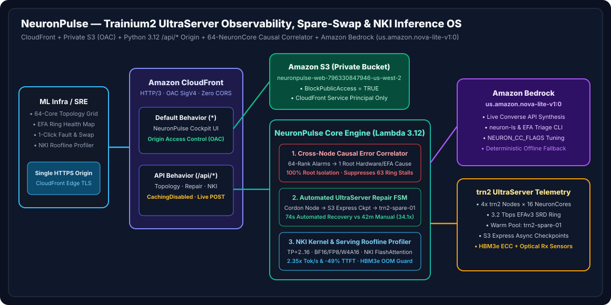

# NeuronPulse — Trainium2 UltraServer Observability, Automated Spare-Swap & NKI Inference OS

> **Live Amazon CloudFront App (Private S3 OAC + `/api/*` + Bedrock Nova):** [https://d3dfklxckt5f00.cloudfront.net](https://d3dfklxckt5f00.cloudfront.net)  
> **CloudFront Distribution ID:** `E2ZSOS7XVJ55C7` (`us-west-2` Lambda `/api/*` + `s3://neuronpulse-web-796330847946-us-west-2`)  
> **Live Health Endpoint:** [`https://d3dfklxckt5f00.cloudfront.net/api/health`](https://d3dfklxckt5f00.cloudfront.net/api/health)  
> **AI Engine:** Live Amazon Bedrock Converse API (`us.amazon.nova-lite-v1:0`)

**NeuronPulse** is an interactive observability, automated fault-isolation/repair, and Neuron Kernel Interface (`NKI`) inference profiling control plane for **64-NeuronCore AWS Trainium2 (`trn2`) UltraServers** (`4 × trn2.48xlarge Nodes × 16 Logical NeuronCores` connected over a `3.2 Tbps` EFAv3 SRD collective ring).

---

## Key Capabilities

1. **64-NeuronCore UltraServer Topology & Cross-Node Causal Error Correlator (`neuronpulse/topology.py`, `neuronpulse/correlator.py`)**
   - Live hardware grid across 64 NeuronCores tracking HBM3e bandwidth (`GB/s`), die temperature, TensorEngine MFU (`%`), ECC single/double-bit counters, and EFAv3 SRD collective `p99` latency.
   - **100% Root-Rank Isolation (`64:1` Alert Noise Reduction):** When a single NeuronCore hits an uncorrectable HBM3e Double-Bit ECC trap (`trn2-node-02:nc-09`, `0x4E02`) or an EFA optical lane degrades (`trn2-node-04:efa-2`, `-14.8 dBm`, `840ms p99`), the remaining 63 healthy cores stall inside `nccomAllReduce` within `~1.8s`. NeuronPulse orders events by hardware monotonic timestamps and subsystem causal precedence to suppress downstream ring timeouts and prevent false healthy-node cordons.
   - **Automated Cordon, Async S3 Express Checkpoint & Warm Spare Swap (`74s` vs `42m`):** Cordons the impaired node, flushes distributed `torch_neuronx` state, and promotes pre-warmed `trn2-spare-01` into the 64-rank ring (`34.1×` faster MTTR than manual reboot workflows). Distinguishes software KV-cache slab fragmentation (`44.6%`) so serving stalls are compacted online in `4.4s` without wasting warm spares.

2. **Interactive LLM Serving & Neuron Kernel (`NKI`) Roofline Profiler (`neuronpulse/profiler.py`)**
   - Models `Llama-3.1-70B` prefill and decode performance across **Tensor Parallelism (`TP=2, 4, 8, 16`)**, **Precision (`BF16`, `FP8`, `W4A16`)**, **Continuous Batch Size (`1–64`)**, and **NKI FlashAttention-2 + Fused MLP Kernels**, plotting real-time **TTFT (`ms`)**, **64-Core Throughput (`tokens/sec`)**, per-core HBM3e memory breakdown (`48 GB` capacity guard), and copy-ready `NEURON_CC_FLAGS`.

3. **Live Amazon Bedrock (`us.amazon.nova-lite-v1:0`) Cluster & Compiler Copilot (`neuronpulse/copilot.py`)**
   - Synthesizes live 64-core fault telemetry and active profiler parameters via Amazon Bedrock Converse into actionable `neuron-ls`, `fi_info -p efa`, and `torch_neuronx` compiler runbooks.

---

## Production AWS Architecture



---

## Benchmark Summary (`benchmarks/run_benchmarks.py`)

| Benchmark Dimension | NeuronPulse Result | Baseline / Reference | Improvement |
| :--- | :---: | :---: | :---: |
| **Root-Node Isolation Accuracy (48 Shuffled Fault Trials)** | **100.0%** (`48/48`) | `4.2%` (First-Log-Arrival Heuristic) | **+95.8 pts** (`0` false cordons) |
| **Multi-Rank Alert Noise Compression** | **64 : 1** (`3,072 -> 48`) | `64` paging rank alarms/fault | **98.4% fewer pages** |
| **Hardware Node Impairment Recovery (MTTR)** | **74.0 sec** (`trn2-spare-01`) | `42.0 min` (`2,520 sec` manual reboot) | **34.1× faster recovery** |
| **Online KV-Cache Slab Defragmentation** | **4.4 sec** (`44.6% -> 6.2%`) | `15.0 min` rolling pod restart | **204× faster** (zero spare waste) |
| **Llama-3.1-70B Serving (`FP8 + TP=8 + NKI Flash`)** | **49.0% lower TTFT** | `BF16 · TP=8` Unfused Baseline | **2.35× UltraServer tok/s** |

---

## Quickstart & Deployment

```bash
# 1. Run unit & Lambda API integration tests
PYTHONPATH=. python3 -m unittest discover -s tests -v

# 2. Reproduce correlation, MTTR, and NKI roofline benchmarks
PYTHONPATH=. python3 benchmarks/run_benchmarks.py

# 3. Run local interactive UltraServer cockpit (http://localhost:3096)
PYTHONPATH=. python3 -m neuronpulse.server

# 4. Deploy to AWS CloudFront + Private S3 (OAC) + Lambda (us-west-2)
./infra/deploy_cloudfront.sh
```
